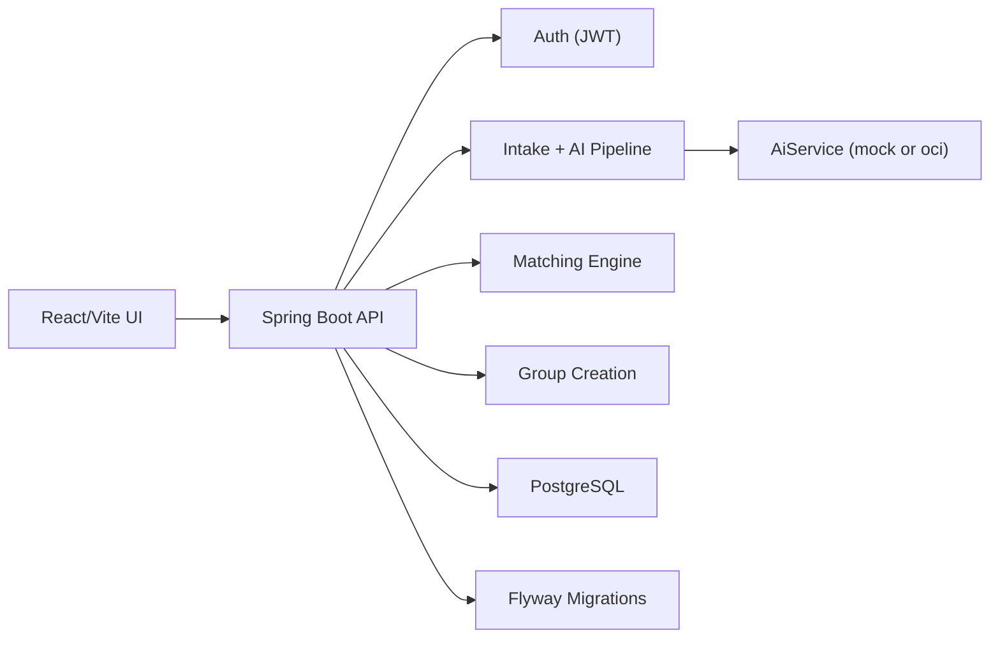

# Project Irene

AI-assisted privacy-preserving matching engine for affordable therapist-led group sessions.

## What this demo includes

- Java/Spring Boot backend (`backend/`) with modular monolith packages
- React/Vite frontend (`frontend/`) with intentional visual styling for screen-share demos
- PostgreSQL via Docker Compose
- Intake pipeline with AI extraction/risk/embedding abstraction (`mock` and `oci` modes)
- Matching engine with hard filters + weighted soft scoring
- Therapist-approved group creation from match results
- Synthetic seed data for a complete local demo flow

## Stack

- Backend: Java 17, Spring Boot 3, Maven, JPA, Flyway, JWT Security, OpenAPI
- Data: PostgreSQL (local), H2 (tests)
- Frontend: React 18 + Vite
- AI integration layer: `AiService` with `MockAiService` and `OciAiService`

## Repository layout

- `AGENTS.md` project standards and completion rules
- `backend/` Spring Boot service
- `frontend/` React app
- `docker-compose.yml` local PostgreSQL

## Local setup

### 1) Start database

```bash
docker compose up -d
```

### 2) Run backend

```bash
cd backend
mvn spring-boot:run
```

Backend URLs:

- API base: `http://localhost:8080/api/v1`
- Swagger UI: `http://localhost:8080/swagger-ui.html`
- Health: `http://localhost:8080/api/v1/health`

### 3) Run frontend

```bash
cd frontend
npm install
npm run dev
```

Frontend URL:

- `http://localhost:5173`

## Seeded demo users

All users use password `Password@123`.

- Therapist: `therapist@irene.app`
- Admin: `admin@irene.app`
- Patients: `patient1@irene.app` to `patient8@irene.app`

## AI mode configuration

`backend/src/main/resources/application.yml`:

- `app.ai.mode=mock` (default, deterministic local behavior)
- `app.ai.mode=oci` (calls configured endpoints)

`application-local.yml` supports:

- `OCI_CHAT_ENDPOINT`
- `OCI_EMBEDDING_ENDPOINT`
- `OCI_GENAI_API_KEY`
- `OCI_CHAT_MODEL`
- `OCI_EMBEDDING_MODEL`
- `GEMINI_API_KEY`
- `GEMINI_MODEL`
- `GEMINI_EMBEDDING_MODEL`
- `GEMINI_BASE_URL`

When `AI_MODE=oci`, the backend now attempts OCI first and automatically falls back to Gemini if OCI calls fail and `GEMINI_API_KEY` is configured.

## Public API endpoints (v1)

- `POST /api/v1/auth/register`
- `POST /api/v1/auth/login`
- `POST /api/v1/therapist/templates`
- `GET /api/v1/therapist/templates/{id}`
- `POST /api/v1/intake/submissions`
- `POST /api/v1/matching/run/{templateId}`
- `GET /api/v1/matching/results/{templateId}`
- `POST /api/v1/groups/create-from-match`

## Architecture overview



## 10-minute demo flow (interview script)

1. Login as therapist (`therapist@irene.app`) in UI.
2. Open therapist template section and create/inspect a template.
3. Run matching for template `1` and show ranked candidates.
4. Point out that high-risk intake is excluded from normal matching.
5. Select candidates and create a group from the run.
6. Switch to patient account and submit a new intake.
7. Show the AI output (issue tags, goals, summary, risk level).
8. Return to therapist and run matching again to show updated cohort list.

## Key curl examples

### Register

```bash
curl -X POST http://localhost:8080/api/v1/auth/register \
  -H 'Content-Type: application/json' \
  -d '{"email":"new_patient@irene.app","password":"Password@123","role":"PATIENT"}'
```

### Login

```bash
curl -X POST http://localhost:8080/api/v1/auth/login \
  -H 'Content-Type: application/json' \
  -d '{"email":"therapist@irene.app","password":"Password@123"}'
```

### Submit intake

```bash
curl -X POST http://localhost:8080/api/v1/intake/submissions \
  -H 'Content-Type: application/json' \
  -H 'Authorization: Bearer <TOKEN>' \
  -d '{
    "ageBand":"18-24",
    "languageCode":"en",
    "timezone":"Asia/Kolkata",
    "region":"IN",
    "availabilitySlots":["mon-19:00","wed-19:00"],
    "groupSharingComfort":"MEDIUM",
    "structuredAnswers":"{\"stress\":\"high\"}",
    "freeText":"I feel social anxiety and loneliness.",
    "goals":["confidence","connection"],
    "consentAi":true,
    "consentGroup":true,
    "notEmergencyAck":true
  }'
```

### Run matching

```bash
curl -X POST http://localhost:8080/api/v1/matching/run/1 \
  -H 'Authorization: Bearer <THERAPIST_TOKEN>'
```

### Create group from match

```bash
curl -X POST http://localhost:8080/api/v1/groups/create-from-match \
  -H 'Content-Type: application/json' \
  -H 'Authorization: Bearer <THERAPIST_TOKEN>' \
  -d '{
    "templateId":1,
    "runId":"<RUN_ID>",
    "title":"Anxiety Cohort - Week 1",
    "patientIds":[3,4,5]
  }'
```

## Test status

Backend tests are implemented and pass:

```bash
cd backend
mvn -Dmaven.repo.local=/tmp/m2 test
```

Current suite includes:

- `AuthIntegrationTest`
- `IntakeControllerTest`
- `MatchingServiceTest`

## Safety scope for this prototype

- Synthetic demo data only
- Adults-only framing
- Explicit not-for-emergency acknowledgement
- Therapist approval required before cohort creation
