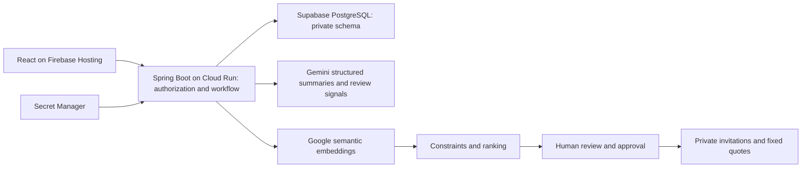

# Project Irene

A working app for affordable, therapist-led group support. Participants share their concerns privately, check their own summary, and choose whether to accept a therapist-approved circle at a fixed fee. Peers cannot see one another’s intake.

**Fictional data only.** This repository does not operate a clinical service or provide emergency monitoring. The local demo uses deterministic simulation. The deployed demo uses real Gemini generation and embeddings, Cloud Run and Supabase PostgreSQL. Live technical integration has been verified; clinical validity has not.

**[Open Irene](https://project-irene-fd39e.web.app)** · [Watch the 2:41 demo](https://drive.google.com/file/d/1VxKqMv-1Tg9g7m6cUbuaK8eWOmsG7w3e/view) · [Pitch deck](docs/submission/Irene-AI-Builder-Cup.pdf)

**Release status — 12 October 2026:** app deployed, source public, prescribed-template deck complete, and final video uploaded with link viewing enabled. [Current product scope](docs/PRODUCT_BUILD_PLAN.md) · [Deployment and rollback](docs/DEPLOYMENT_STATUS.md).

## Run the complete app

Install Java 17+, Maven and Node.js 20+, then run from the repository root:

```sh
bash scripts/run-demo.sh
```

Open **http://127.0.0.1:8080**. The launcher builds the interface and backend and starts one app with an embedded, persistent demo database. No Docker, PostgreSQL or Google account is needed. Stop with Ctrl+C. Fictional records persist under `.irene-demo/`; set `IRENE_DEMO_DB` to a different file path for a separate demo. `PORT` changes the listening port. If needed, `IRENE_MAVEN_REPO` selects an existing Maven dependency cache.

Click a demo role, then Login. Local accounts use `Password@123`: `patient1@irene.app` through `patient8@irene.app`, `therapist@irene.app`, and `admin@irene.app`. These documented credentials must never be used for a public deployment. Existing databases are not reseeded; for an old demo without verified credentials, use a new fictional demo database.

## What works

- Three role-specific workspaces: participant, therapist and administrator.
- Adult intake with explicit consent, practical preferences, availability and budget; editable summary requiring participant confirmation.
- Assigned therapist review, recorded rationale and separate individual-review outcomes. High or uncertain risk cannot enter routine matching.
- Constraint filtering and semantic ranking with explanations. Group proposals remain private until approval.
- Final approval rechecks the intake, program schedule, every participant’s availability, budget and existing invitations.
- Fixed per-person quotes, private invitation acceptance/decline/withdrawal, cancellation, session completion and private experience feedback. No payment collection.
- Therapist-supplied Google Meet links, discreet downloadable calendar events and private facilitator preparation drafts. Irene does not create or verify Meet rooms.
- Participant data export and deletion, including derived matching data and affected preparation drafts.
- Professional applications and administrator verification before therapist access. Administrators cannot browse private matching results.
- Live Google AI generation and embeddings, Firebase Hosting frontend, Cloud Run backend, Supabase PostgreSQL, Secret Manager credentials, and a container built through Cloud Build and stored in Artifact Registry.

## Demo journey

1. Participant demo → Private intake → choose availability and budget → Your story → use the fictional example and select consent.
2. Prepare the summary, correct it, and confirm. It now appears in the chosen therapist’s review queue.
3. Therapist demo → Intake review → write a fictional review note → approve for group consideration.
4. Build a circle → College Stress & Anxiety → find reviewed participants → select two or more → save a proposal.
5. My circles → choose a future Monday or Wednesday at 19:00 **Asia/Kolkata**, a fee within everyone’s budget, and a Meet URL. Confirm suitability and approve. A ₹2,400 total shared by four people quotes ₹600 each; no payment occurs.
6. Participant demo → My circles → accept the exact quote → view preparation and save the private calendar event. The illustrative Meet link does not represent a booked room.
7. Explore Privacy & data and the professional verification flow. Use separate accounts for participant and professional roles. Session completion becomes available after the scheduled end.

See [demo narration and submission checklist](docs/DEMO_AND_SUBMISSION.md).

## Google AI and deployment

For fictional local input, set `AI_MODE=google`, `GOOGLE_AI_PROVIDER=gemini`, and `GEMINI_API_KEY` in the backend environment. Keep keys out of frontend configuration and Git. Defaults are `gemini-3.8-flash` and `gemini-embedding-001`. Models are configurable and require live verification for the selected account.

The live deployment uses the `hosted` profile:

| Component | Used in the live app |
| --- | --- |
| Frontend | React/Vite on Firebase Hosting (Spark) |
| Backend | Java/Spring Boot on Cloud Run, Mumbai; minimum 0, maximum 2 instances |
| Database | Supabase PostgreSQL through a certificate-verified TLS session pooler |
| Generation | Gemini Developer API, `gemini-3.5-flash-lite` |
| Similarity features | `gemini-embedding-001`, 768-dimensional embeddings |
| Credentials | Secret Manager and a dedicated runtime service identity |
| Build and image storage | Cloud Build and Artifact Registry |

The hosted profile disables demo seeding and API documentation, restricts CORS to the two Firebase origins, and includes database readiness checks. The default models above apply to local configuration; the deployed generation model is explicitly overridden as shown in this table.

Firebase/Gemini are in an unbilled project; Cloud Run is in a separate trial-backed project. Firestore and Firebase Authentication are not used: PostgreSQL stores application data and Irene manages role-based accounts. Gemma and ADK are not integrated. The alternative `cloud` configuration contains Vertex, Sensitive Data Protection and Cloud SQL paths, but none is used by this deployment. Developer API mode uses basic email masking and remains fictional-data-only; India-only AI processing is not promised.

[Beginner deployment checklist](docs/GOOGLE_CLOUD_SETUP.md) covers costs, every console step, first-admin bootstrap, verification and rollback. The app is deployed; current resource identifiers and verification evidence are in [deployment status](docs/DEPLOYMENT_STATUS.md). The hosted deployment script defaults to `--plan`; only an explicit `--apply` deploys. Do not use the older Cloud SQL deployment script for the Supabase setup.

## Visual design

The coral-and-ivory interface was developed with [Google Stitch](https://stitch.withgoogle.com/projects/9466470167606787209): an initial three-screen study followed by a refined desktop landing and mobile concept. The React implementation adapts its Playfair Display / Plus Jakarta Sans typography, sunset palette, circular artwork, and editorial layouts to Irene's actual workflow. Stitch is a design-time tool, not a live application dependency.

The landing includes an accessible shared-cost slider and sign-in shortcuts. The same design system covers all role workspaces, intake steps, reviews, invitations and privacy controls. Layouts adapt to smaller screens; keyboard focus, a skip link, and reduced-motion preferences are supported. Typography uses Google Fonts with local system fallbacks. No real participant information was submitted to Stitch.

## Architecture

Java 17 / Spring Boot 3 modular monolith, React/Vite, PostgreSQL and Flyway. Local demo uses H2 in PostgreSQL compatibility mode. Authentication uses BCrypt passwords and short-lived bearer tokens held in browser memory; refreshing requires signing in again.



AI failures do not fall back to simulated success. A failed risk check becomes `REVIEW_REQUIRED`; failed extraction or embedding returns an error and rolls back the operation. Embedding provenance prevents mixing incompatible model vectors. Human review controls group approval. Application permissions do not anonymize Google Meet identities or guarantee confidentiality between attendees.

For normal development, start PostgreSQL with `docker compose up -d`, run `mvn spring-boot:run` in `backend`, and `npm ci && npm run dev` in `frontend`. Vite proxies to port 8080. OpenAPI is `/swagger-ui.html`; health is `/api/v1/health`.

## Verification

```sh
mvn -s backend/.mvn/public-settings.xml -gs backend/.mvn/public-settings.xml -f backend/pom.xml verify
npm run build --prefix frontend
```

The public Maven settings avoid modifying a machine’s global corporate mirror configuration. Automated tests cover hosted-profile CORS, health probes and access restrictions, auth, ownership, AI parsing/failure handling, matching constraints and the complete workflow, including invalid schedules, budget limits, stale intake, privacy and cancellation. Tests use H2 and a fake Google HTTP server; they do not prove PostgreSQL deployment, live Google behavior or clinical validity. See [release verification](docs/RELEASE_VERIFICATION.md).

## AI Builder Cup submission

**Team: Model Citizens · Team leader: Debadrita Dutta**

**Theme: Sustainability & Social Impact**

Irene began with the experience of needing therapy in college, finding it expensive, and hesitating to tell parents because they would worry. The aim is a more affordable first step into professionally guided group support, with a private intake before any decision to share in a group.

- [Live product](https://project-irene-fd39e.web.app)
- [Prescribed-template pitch deck (PDF)](docs/submission/Irene-AI-Builder-Cup.pdf)
- [Editable pitch deck (PowerPoint)](docs/submission/Irene-AI-Builder-Cup.pptx)
- [Narrated English demo (2:41)](docs/submission/video/Irene-Demo-English.mp4)
- [Watch the demo on Google Drive](https://drive.google.com/file/d/1VxKqMv-1Tg9g7m6cUbuaK8eWOmsG7w3e/view)
- [Brief description for the submission form](docs/submission/Brief-Description.txt)
- [Verification evidence](docs/RELEASE_VERIFICATION.md)

The deck uses all 16 slides from the organizer’s supplied template, including its instructional and closing slides. It includes current architecture, actual fictional-data product screens and intended societal impact. Firestore is not integrated; Supabase PostgreSQL is the deployed database. Real-world impact, clinical suitability and sustainable service economics still need validation.

The owner reports written organizer approval to rebuild Irene; that correspondence remains private. Competition submission itself must be completed in the organizer dashboard. See the [submission checklist](docs/DEMO_AND_SUBMISSION.md).

### Live sign-in spaces

The login card now offers Participant, Therapist and Admin entry points. The backend account role determines permissions. Selecting Therapist with an unverified account opens its professional application; a verified account opens the therapist workspace. New professional registration creates an unprivileged account first, then requests administrator review. Admin has no public registration path. Existing private demo logins are in the ignored `deploy/hosted/local-credentials.json` file on the deployment computer.

Google AI drafts intake summaries, extracts concerns/goals, flags possible risks for review, produces embeddings used by the matching scorer, and prepares private facilitator briefs. Schedule, language, budget and other constraints are enforced by application logic; therapists review suitability and approve groups. The UI explains AI assistance in How it works.

Run the frontend role-routing checks with `node --test frontend/tests/authRouting.test.js`. Intake consent and role authorization are enforced independently of the selected sign-in entry point.
