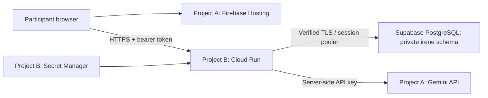

# Irene: low-cost deployment

Updated on 10 October 2026 after the authorized deployment. **Irene is live:** see [deployment status, resource IDs and rollback](DEPLOYMENT_STATUS.md). The walkthrough below remains a reproducible setup guide; do not recreate existing resources blindly. Commands can create resources and incur charges. The Google account remains on free trial, and Firebase/Gemini remain unbilled.

Use fictional participants and fictional concerns throughout. This is a project demonstration, not a clinical service. Developer API mode uses basic email masking, not comprehensive de-identification. Keep the app's consent, therapist review and role restrictions enabled.

## 1. Is this architecture a better choice?

**Yes, for Irene's small, intermittently used demo.** It avoids an always-running Google database while retaining the existing Java/PostgreSQL implementation. There are three accounts/services to manage, and the free database can pause. It is not the simplest all-Google production architecture.

| Part | Selected service | Reason and tradeoff |
| --- | --- | --- |
| React/Vite frontend | Firebase **Hosting**, Spark plan | Static site with HTTPS and SPA routing. No application server needed. |
| Spring Boot API | Cloud Run, request-based billing | Minimum 0, maximum 2 instances; cold starts after idle periods. |
| PostgreSQL | Supabase Free | Existing SQL/Flyway code works without rewriting for Firestore. No ongoing base database fee; limited resources and no managed free backups. |
| AI | Gemini Developer API, free tier | Key stays in the backend. Account/model quotas can interrupt demonstrations. |
| Credentials | Google Secret Manager | Runtime identity reads only the named secrets; no downloaded service-account keys. |
| Build/image | Cloud Build and Artifact Registry | Reproducible backend image; image storage and builds have separate billing. |

Firebase App Hosting requires Blaze and is unnecessary for this Vite SPA. Firestore would require redesigning the relational workflow. Cloud SQL remains an alternative if an all-Google database matters more than ongoing cost; its special trial instance is temporary. The existing `cloud` profile and old `deploy/deploy.sh` target that different architecture—**do not use them for this guide**. [Firebase App Hosting costs](https://firebase.google.com/docs/app-hosting/costs), [Cloud SQL trial](https://docs.cloud.google.com/sql/docs/postgres/free-trial-instance).

### Keep frontend/AI and backend billing separate

Create two Google projects, once you choose to deploy:

- **Project A: frontend + AI.** Firebase Spark and Gemini free tier. Leave this project unlinked from Cloud Billing. The API key belongs to this project.
- **Project B: backend.** Cloud Run, Secret Manager, Cloud Build and Artifact Registry. This project needs billing, even when usage fits free allowances. An eligible free trial can cover eligible Cloud usage.

These are ordinary project boundaries, not a way to multiply quotas. Do not create projects to bypass AI limits. Keeping A unbilled prevents enabling Cloud Run from unintentionally moving its Gemini usage to paid billing. Google welcome/free-trial credits do **not** fund the Gemini Developer API. [Gemini billing](https://ai.google.dev/gemini-api/docs/billing).



The browser calls the Cloud Run URL directly. There is no Firebase-to-Cloud-Run rewrite, Supabase browser client, or Firebase SDK requirement. Firebase serves the interface; Irene's existing authentication handles accounts.

## 2. Expected costs and billing risks

Amounts below are USD before local taxes/conversion. Recheck the linked pages before activating billing; regional rates, model availability and quotas change.

| Service | Planning expectation for a small demo | Limit/risk |
| --- | --- | --- |
| Firebase Spark | $0 within its allowances | 10 GB Hosting storage and 10 GB/month transfer. On Spark, exhausting allowances can stop service rather than buy more capacity. [Hosting quotas](https://firebase.google.com/docs/hosting/usage-quotas-pricing) |
| Supabase Free | $0 | 500 MB database, 5 GB egress, limited active projects; may pause after a week of inactivity. Automatic backups are not included. Pro starts at $25/month if you choose to upgrade. [Supabase pricing](https://supabase.com/pricing) |
| Cloud Run | Often $0 for a light demo; not guaranteed | Request-based free allowance includes 2 million requests, 180,000 vCPU-seconds and 360,000 GiB-seconds/month, subject to billing-account aggregation and regional pricing. External network transfer is separate. [Cloud Run pricing](https://cloud.google.com/run/pricing) |
| Gemini | $0 on an eligible unbilled project within model quotas | Flash-Lite has a free tier. Paid `gemini-3.5-flash-lite` standard pricing currently lists $0.30/M input and $2.50/M output tokens. Embeddings are a separate quota/cost. Free-tier content can be used to improve Google products: fictional data only. [Gemini pricing](https://ai.google.dev/gemini-api/docs/pricing) |
| Secret Manager | Usually $0 with the four required secrets and optional bootstrap secret | 6 active versions and 10,000 accesses/month free across the billing account. Disabled versions still count; rotations can exceed the allowance. [Secret Manager pricing](https://cloud.google.com/secret-manager/pricing) |
| Artifact Registry | $0 or a small storage charge | First 0.5 GB storage free; keeping many Java images increases storage. Retain the current and rollback images. [Registry pricing](https://cloud.google.com/artifact-registry/pricing) |
| Builds, source uploads, logs | Small but separate | Repeated builds, source-bucket storage and excessive logs can cost money. Do not log intake text, tokens or keys. Check actual build-machine prices in [Cloud Build pricing](https://cloud.google.com/build/pricing). |

For a few teammates and judges over twelve days, **$0 is plausible** if all usage stays inside available allowances. A discretionary **$1–$5 buffer** for build/storage/network overages is a planning estimate, not a quote, cap or spending authorization. Busy traffic or repeated AI calls can exceed it. Example if you deliberately enable paid AI later: 1M input + 250,000 output tokens on the listed Flash-Lite model costs about $0.93, before embeddings or other services.

Minimum zero avoids a continuously warm instance, but startup, active requests, networking and retained resources can still be billed. Maximum two limits scaling, not total spend or calls to Gemini. Deployments can temporarily overlap instances. Public registration is available; CORS does not prevent automated clients from calling an API. A broad public launch needs additional abuse/rate controls; keep this release to a controlled fictional-data demo and use low AI quotas.

In Project B, open **Billing → Budgets & alerts → Create budget**. Choose the project, a monthly amount you are comfortable with (for example $5), and email thresholds at 50%, 90% and 100%. **Budget emails do not stop spending.** If service-level spend caps are offered for your account, inspect their coverage; do not assume they cover storage, builds or all services. [Budgets and spend caps](https://docs.cloud.google.com/billing/docs/how-to/budgets-spend-caps).

An eligible Google trial currently offers $300 for 90 days and does not automatically become a paid account. You must personally complete any terms/payment verification and decide whether to upgrade. If you remain on trial, services can stop when the trial ends. [Google free program](https://docs.cloud.google.com/free/docs/free-cloud-features).

## 3. What is already prepared in the repository?

| File | Purpose |
| --- | --- |
| `firebase.json` | Serves `frontend/dist`, rewrites application routes to `index.html`, adds security and revalidation headers. |
| `frontend/.env.production.example` | Public API URL only; no secret belongs in a `VITE_` variable. |
| `backend/src/main/resources/application-hosted.yml` | PostgreSQL TLS, dedicated schema, Hikari limits, exact CORS origins, real Google mode, no seed accounts, limited health output, disabled API documentation. |
| `deploy/hosted/Dockerfile` | Backend-only Java 17 container, runs tests while building, non-root runtime. |
| `deploy/hosted/cloudbuild.yaml` | Builds and stores an image; does not deploy it. |
| `deploy/hosted/env.example.yaml` | Non-secret backend settings with placeholders. |
| `deploy/hosted/supabase-bootstrap.sql` | Creates the dedicated database role/schema without embedding a password. |
| `deploy/hosted/build-frontend.sh` | Validates the API URL and builds the frontend; no upload. |
| `deploy/hosted/deploy-backend.sh` | Defaults to a local command preview. Only explicit `--apply` deploys. |
| `.gcloudignore`, `.dockerignore`, `.gitignore` | Exclude credentials, private settings and local data from uploads/builds/Git. |

For an existing deployment, update the private environment file to `SPRING_PROFILES_ACTIVE: hosted` before deploying a newly built image. Existing running revisions are unchanged.

The templates use placeholders; deployed resource IDs are recorded in DEPLOYMENT_STATUS.md. Credentials and private environment files are excluded from Git and uploads. Use only the `hosted` profile in Cloud Run; never add `demo` or `local`. The dedicated profile uses real Gemini and fails on missing configuration. It never silently substitutes demo success.

## 4. Prepare your computer and record project IDs

A project **name** is a display label; its **ID** is the unique identifier used in commands. Keep a private note with Project A ID, Project B ID, region, Supabase project reference and final service URL. No passwords in that note or this repository.

Install Java 17, Maven, Node.js 20+, a PostgreSQL client (`psql` and `pg_dump`), the [Google Cloud CLI](https://docs.cloud.google.com/sdk/docs/install) and [Firebase CLI](https://firebase.google.com/docs/cli). The Firebase CLI can be installed with `npm install -g firebase-tools`. Google Cloud Shell can replace a local Google CLI installation, but the source must then be available there. Do not upload local demo databases or private configuration.

Run future commands from the repository root, replacing uppercase placeholders first:

```sh
export IRENE_PROJECT_ID='YOUR_BACKEND_PROJECT_B_ID'
export IRENE_FIREBASE_PROJECT_ID='YOUR_FRONTEND_PROJECT_A_ID'
export IRENE_REGION='asia-south1'
```

Use Mumbai (`asia-south1`) for the backend and choose a nearby Supabase region if available. External-provider traffic still has network and privacy implications; this configuration does not promise India-only AI processing.

## 5. Create Project A: Firebase Hosting and Gemini

1. Open [Firebase Console](https://console.firebase.google.com/), click **Create a project**, and give it an Irene demo name. Record the exact project ID. Optional Google Analytics is unnecessary for this demonstration.
2. Confirm the plan shown in the console is **Spark**. Do not attach a billing account to this project.
3. Open **Build → Hosting → Get started**. Choose ordinary Hosting, not App Hosting. Skip framework setup and do not run `firebase init` over the supplied configuration. You do not need to add a Firebase Authentication or Firestore product.
4. Record the default addresses `https://PROJECT_A_ID.web.app` and `https://PROJECT_A_ID.firebaseapp.com` for CORS. Custom domains and preview channels require separately adding their exact origins later.
5. Open [Google AI Studio](https://aistudio.google.com/), then its **API keys / Projects** area. Import/select the existing Project A. Create an API key for that exact project, and confirm the plan is Free. If an account cannot access the free tier, stop and revisit the budget instead of enabling billing accidentally.
6. In Google Cloud Console for **Project A**, open **APIs & Services → Credentials**, select the key and restrict its API access to the **Generative Language API**. Do not use browser-referrer restrictions for a server key; Cloud Run calls it from the backend. Keep the key private until adding it to Project B's Secret Manager.
7. Check AI Studio's available models and rate-limit screen. The sample selects `gemini-3.5-flash-lite` for generation and `gemini-embedding-001` for the existing text similarity adapter. Current docs still list that embedding model. Model access and quotas must be verified with this account; Google now restricts 2.5 models for new projects. [Model availability/deprecations](https://ai.google.dev/gemini-api/docs/deprecations), [text embeddings](https://ai.google.dev/gemini-api/docs/embeddings).

Do not change embedding models on an existing populated database without a re-embedding plan: vectors from different models cannot be compared. Irene records embedding provenance. Do not enable paid AI, automatic top-ups, search grounding or extra paid tools as part of this guide.

## 6. Create Project B: the backend infrastructure

1. Open [Google Cloud Console](https://console.cloud.google.com/), use the project picker near the top, and choose **New project**. Create a separate backend project and record its ID.
2. If required, complete billing/free-trial signup yourself. Keep Project A unbilled. Review the account's trial status and set the budget alerts described above before building anything.
3. With **Project B selected**, open **APIs & Services → Library**. Search for and enable **Cloud Run Admin API**, **Cloud Build API**, **Artifact Registry API** and **Secret Manager API**. The console may also request its normal supporting APIs. Cloud SQL, Vertex AI, Firestore and Sensitive Data Protection are not required by this profile.
4. Open **IAM & Admin → Service Accounts → Create service account**. Name it `irene-runtime`. Do not grant Owner, Editor or project-wide Secret Accessor. Do not create/download a JSON key. Record its email, normally `irene-runtime@PROJECT_B_ID.iam.gserviceaccount.com`.
5. Create a second service account named `irene-builder`. This identity will build images; it must not read application secrets.
6. Open **Artifact Registry → Repositories → Create repository**. Name it `irene`, select **Docker**, choose the region from your note, and use standard Google-managed encryption. In this repository's permissions, grant `irene-builder` **Artifact Registry Writer**. In project IAM, grant that builder **Logs Writer**.
7. Open **Cloud Storage → Buckets → Create**. Use a globally unique name such as `PROJECT_B_ID-irene-build-source`, the same region, Standard storage and uniform bucket-level access. Leave public access prevention enabled. This private bucket holds build source, never secrets. Grant `irene-builder` **Storage Object Viewer** on this bucket. Your signed-in deployment user needs upload permission there.
8. Your deployment user needs permission to submit Cloud Builds and deploy/manage Cloud Run, plus **Service Account User** on `irene-builder` and `irene-runtime`. The account that owns a newly created personal project may already have sufficient permissions. For a teammate, use the specific **Cloud Build Editor**, **Cloud Run Admin** and **Service Usage Consumer** roles as needed, with bucket upload permissions, rather than adding Owner. Secret creation/IAM changes require an administrator; runtime itself needs none of those administrative roles.

The builder roles support the supplied explicit Cloud Build configuration. If an organization policy blocks service creation or the build identity, resolve that specific permission in the console; do not make the bucket public or give the runtime account broad access.

## 7. Create Supabase and connect PostgreSQL safely

1. Open [Supabase](https://supabase.com/dashboard), create a **Free** organization/project, choose a nearby region, and save its generated database administrator password in a password manager. Do not enable a paid upgrade.
2. Click the project's **Connect** button. Choose **Session pooler**, not Transaction pooler. Copy the exact hostname, port **5432**, database `postgres` and project reference. The session pooler provides IPv4 compatibility for ordinary Cloud Run outbound networking. Direct Supabase connections can require IPv6; the transaction pooler's port 6543 has different prepared-statement behavior. [Connection options](https://supabase.com/docs/guides/database/connecting-to-postgres).
3. In the database's SSL settings, download the server root CA certificate. Keep it outside the repo. Enable SSL enforcement if offered. Irene uses `sslmode=verify-full`, checking both the CA and hostname. Never fix a certificate error by using `sslmode=disable`, a trust-all factory or disabling certificate verification. [Supabase SSL guidance](https://supabase.com/docs/guides/platform/ssl-enforcement).
4. In **SQL Editor**, run the contents of `deploy/hosted/supabase-bootstrap.sql` once as the project administrator on this new database. It creates login role `irene_app` and schema `irene`. If they already exist, inspect ownership and grants first; do not drop an existing schema or rerun blindly.
5. Set the new role's password privately with `psql` using the session-pooler admin connection below. `-W` prompts for the Supabase administrator password; `\password` prompts for the new application password without placing it in shell history or an SQL file. Keep the application password in your password manager.

```sh
psql "host=YOUR_SESSION_POOLER_HOST port=5432 dbname=postgres user=postgres.YOUR_SUPABASE_REF sslmode=verify-full sslrootcert=/absolute/private/path/supabase-ca.crt" -W
```

Inside `psql`:

```text
\password irene_app
\q
```

6. Repeat the connection using `user=irene_app.YOUR_SUPABASE_REF`, entering the **application** password. Check `SELECT current_user, current_schema();` reports `irene_app` and `irene`. Use `\conninfo` to confirm TLS. Do not put a password in the connection string.
7. In Supabase's **Data API / API settings**, keep `irene` out of **Exposed schemas**. This app does not use Supabase's public Data API. The supplied SQL revokes access to the schema from `PUBLIC`, `anon`, `authenticated` and `service_role`; browser users must go through Irene's role/ownership checks. Do not grant those roles table access. [Securing the Data API](https://supabase.com/docs/guides/api/securing-your-api).

At startup Flyway creates/updates tables in `irene`, then Hibernate validates them. Flyway is not allowed to create the schema automatically in the hosted profile. The app role owns only its application schema so it can run migrations; it is not the `postgres` administrator. A larger production setup should separate the migration identity from runtime.

Hikari uses at most **5 connections per instance**, with zero minimum idle connections. Two nominal instances therefore use up to ten application connections, plus administration and temporary deployment overlap. Check Supabase's actual pool limits in your project's settings. No Cloud SQL connector, VPC connector, static egress IP or paid IPv4 add-on is required by this session-pooler approach.

## 8. Add secrets in Project B

In Google Cloud Console, select **Project B → Secret Manager → Create secret**. Use automatic replication unless you have a separate residency requirement. Create these names with their respective values:

| Secret name | Value entered privately | Runtime destination |
| --- | --- | --- |
| `irene-db-password` | Dedicated `irene_app` password | `DATABASE_PASSWORD` |
| `irene-jwt-secret` | New random signing secret, at least 32 bytes | `APP_JWT_SECRET` |
| `irene-gemini-key` | API key belonging to unbilled Project A | `GEMINI_API_KEY` |
| `irene-supabase-ca` | Entire downloaded PEM certificate, including BEGIN/END lines | `/var/run/secrets/supabase/ca.crt` |
| `irene-bootstrap-password` | Unique administrator password, at least 16 characters | `BOOTSTRAP_ADMIN_PASSWORD`, first setup only |

Use a password manager to generate the JWT secret, or run `openssl rand -base64 48` privately. Do not paste secret values into chat, screenshots, commit messages or command arguments. The CA is public trust material, but mounting it through Secret Manager avoids baking deployment-specific files into the image.

For **each named secret**, open **Permissions → Grant access**, add the `irene-runtime` email, and assign **Secret Manager Secret Accessor** on that secret only. Record the version number (usually `1`). Numeric versions make rollback reproducible. Leave the builder without access. Never use the published local demo password.

## 9. Prepare private settings and build the backend

Copy the example locally:

```sh
cp deploy/hosted/env.example.yaml deploy/hosted/env.yaml
```

Edit `deploy/hosted/env.yaml`:

- `SUPABASE_POOLER_HOST`: hostname only, from Connect → Session pooler.
- `DATABASE_USER`: `irene_app.YOUR_SUPABASE_REF`.
- `CORS_ALLOWED_ORIGINS`: the two exact HTTPS Firebase addresses, comma separated, no trailing slash or wildcard.
- `GEMINI_MODEL` and `GEMINI_EMBEDDING_MODEL`: models verified in Project A.
- Keep `SPRING_PROFILES_ACTIVE: "hosted"`.
- For the first deployment, add `BOOTSTRAP_ADMIN_EMAIL: "your-private-admin-email"`. Password comes from the bootstrap secret.

This file is ignored by Git, Docker and Cloud Build. It contains settings, not passwords. Do not place secrets in any other environment file.

Sign in using your own account. These are future account/build steps, not required to review the configuration:

```sh
gcloud auth login
firebase login
```

Before uploading, inspect `gcloud meta list-files-for-upload`: it must not list `env.yaml`, certificates, credentials, `.env` files or demo databases. If anything private appears, stop and correct the ignore rules.

Build and push the backend image only:

```sh
gcloud builds submit . \
  --project "$IRENE_PROJECT_ID" \
  --region "$IRENE_REGION" \
  --config deploy/hosted/cloudbuild.yaml \
  --substitutions "_REGION=$IRENE_REGION" \
  --service-account "projects/$IRENE_PROJECT_ID/serviceAccounts/irene-builder@$IRENE_PROJECT_ID.iam.gserviceaccount.com" \
  --gcs-source-staging-dir "gs://$IRENE_PROJECT_ID-irene-build-source/source"
```

If your bucket has a different name, change the last argument. The build runs backend tests and uploads an image tagged with the build ID. In **Artifact Registry → irene → backend**, open the successful image and copy its full **digest** reference: `REGION-docker.pkg.dev/PROJECT_B_ID/irene/backend@sha256:...`. A digest identifies immutable image contents, unlike a reusable tag.

Prepare the local deployment command preview:

```sh
export IRENE_IMAGE='COPY_FULL_IMAGE_REFERENCE_WITH_SHA256_DIGEST'
export IRENE_SERVICE_ACCOUNT="irene-runtime@$IRENE_PROJECT_ID.iam.gserviceaccount.com"
export IRENE_ENV_FILE='deploy/hosted/env.yaml'
export IRENE_DATABASE_SECRET='irene-db-password:1'
export IRENE_JWT_SECRET='irene-jwt-secret:1'
export IRENE_GEMINI_SECRET='irene-gemini-key:1'
export IRENE_CA_SECRET='irene-supabase-ca:1'
export IRENE_ADMIN_SECRET='irene-bootstrap-password:1'
bash deploy/hosted/deploy-backend.sh --plan
```

Use your actual secret version numbers. The preview runs locally and creates nothing. Check the image, project, service account, secret **names**, 0–2 scaling and region before going further.

## 10. Future deployment: private backend first

**This is the first actual deployment step. Do not execute until you decide to deploy.**

```sh
bash deploy/hosted/deploy-backend.sh --apply
```

The service starts private. Settings include 1 CPU, 1 GiB RAM, request-based CPU allocation, concurrency 10, timeout 180 seconds, minimum 0 and maximum 2 at service/revision levels. The JVM uses a bounded fraction of container RAM. Startup checks `/actuator/health/readiness` (including DB); liveness checks `/actuator/health/liveness` (process health). Database outages should not cause liveness restart storms. The readiness URL also supports manual monitoring; this configuration does not enable the separate preview continuous-readiness feature. [Cloud Run deployment flags](https://docs.cloud.google.com/sdk/gcloud/reference/run/deploy), [health checks](https://docs.cloud.google.com/run/docs/configuring/healthchecks).

In **Cloud Run → irene-api**, inspect the latest revision, scaling, security identity, secret versions and logs. Confirm only `hosted` is active and that there are no demo account seed messages. Copy the service's exact HTTPS URL.

For an authenticated private check, run:

```sh
gcloud run services proxy irene-api --project "$IRENE_PROJECT_ID" --region "$IRENE_REGION" --port 8085
```

Leave it running, then in another terminal:

```sh
curl --fail http://127.0.0.1:8085/actuator/health/readiness
curl --fail http://127.0.0.1:8085/actuator/health/liveness
curl --fail http://127.0.0.1:8085/api/v1/health
```

Expect status `UP` from the probes and `demoAccounts` false from app health. These endpoints must not expose database addresses, credentials or health-component details. A successful boot should have created Flyway's history and application tables under Supabase's `irene` schema.

Only after this private check succeeds, make the backend reachable by ordinary browser clients: **Cloud Run → irene-api → Permissions → Grant access**, principal `allUsers`, role **Cloud Run Invoker**. If the console groups this under Security, retain the IAM invoker check and grant the invoker role. Do not disable Irene's JWT authentication or role checks. This intentionally permits public HTTP entry, including registration/login; private API data still requires an Irene token. If organizational policy prohibits public invokers, do not bypass it—this direct browser architecture will need an approved access design.

## 11. Build and publish Firebase Hosting

Set the exact public API address, including `/api/v1`:

```sh
export VITE_API_BASE='https://YOUR_EXACT_CLOUD_RUN_URL.run.app/api/v1'
bash deploy/hosted/build-frontend.sh
```

Use the URL copied from Cloud Run rather than constructing a name. The script refuses HTTP, missing `/api/v1`, query strings or embedded credentials. It only builds; no deployment occurs. Alternatively copy `frontend/.env.production.example` to `frontend/.env.production.local` for a private local setting, but still export the URL when using the validation script. Vite settings are embedded at build time, so changing the API URL requires rebuilding the frontend.

When ready to publish the built interface:

```sh
firebase deploy --only hosting --project "$IRENE_FIREBASE_PROJECT_ID"
```

The explicit project prevents deploying to the wrong Firebase project. No `firebase init`, functions deployment or Blaze upgrade is required. Open the returned Hosting URL. `firebase.json` serves the SPA fallback for browser routes, uses revalidation for releases, and supplies basic security headers. The Firebase URL should serve HTML, while API requests in the browser's Network panel go to Cloud Run and return JSON. [Hosting configuration](https://firebase.google.com/docs/hosting/full-config).

## 12. Verify the deployed release before sharing

- **HTTPS and routing:** open both default Firebase addresses, refresh a nested path, and check the interface loads. This app also uses in-page hash navigation. Check on a phone-size viewport.
- **CORS:** from your Firebase page, register/sign in with a fictional participant. A preflight from that exact origin must allow the origin and bearer header. A different origin must not receive an allow-origin response. No wildcard or credentialed-cookie CORS is configured.
- **Authentication:** a request without a token to `/api/v1/experience/workspace` must fail with 401/403; participant tokens must not open administrator or therapist actions. Public probes and registration/login are expected exceptions.
- **Health:** readiness and liveness return `UP`; `/actuator/env` is inaccessible and `/api-docs` is disabled. Readiness must fail when the database cannot be reached. A paused Supabase project needs resuming in its dashboard.
- **Administration:** sign in using the privately bootstrapped admin. Register a separate professional account, review its fictional application and verify it through the admin workflow. Configure a program as the professional. Empty production data is expected: local demo accounts/programs were intentionally not copied.
- **Actual Google integration:** submit one fictional intake with consent. Confirm summary extraction, risk routing and embedding creation complete against Google, then participant confirmation, therapist review, matching, proposal and invitation acceptance. This app does multiple model calls; check AI Studio usage and quota errors. An unavailable/invalid model must produce an error or review requirement, never a fabricated success.
- **Privacy:** use two fictional participants and prove each sees only their own intake/invitations. Check export/deletion and loss of access after sign-out. Do not publish tokens or private notes in the demo video.
- **Cost/performance:** inspect Cloud Run metrics after idle time and first-request latency; allow for Java cold starts. Confirm min 0/max 2, AI free-tier status, billing alerts, and Supabase storage/connection usage. Do not add a constant keepalive job merely to hide cold starts.

Example CORS checks, after replacing values (no password/token needed):

```sh
export IRENE_API_ORIGIN='https://YOUR_EXACT_CLOUD_RUN_URL.run.app'
curl -i -X OPTIONS "$IRENE_API_ORIGIN/api/v1/experience/workspace" \
  -H "Origin: https://$IRENE_FIREBASE_PROJECT_ID.web.app" \
  -H 'Access-Control-Request-Method: GET' \
  -H 'Access-Control-Request-Headers: authorization,content-type'
curl -i -X OPTIONS "$IRENE_API_ORIGIN/api/v1/experience/workspace" \
  -H 'Origin: https://unapproved.example' \
  -H 'Access-Control-Request-Method: GET'
curl -i "$IRENE_API_ORIGIN/api/v1/experience/workspace"
```

After the first administrator is confirmed, remove `BOOTSTRAP_ADMIN_EMAIL` from the private env file, run `unset IRENE_ADMIN_SECRET`, and deploy a new revision using the same pinned image and remaining secrets. Verify admin login still works (the account is stored in PostgreSQL). Once no rollback revision needs bootstrap, revoke the runtime's access to that bootstrap secret and disable its version. Do not rotate the JWT secret casually: that invalidates existing tokens.

## 13. Rollback and stop-cost procedure

Before each release, record the previous Cloud Run revision, image digest, secret versions, private settings, Firebase release and database migration version. Preserve the previous image; do not enable a cleanup policy that deletes your rollback image.

**Backend rollback:** in **Cloud Run → irene-api → Revisions → Manage traffic**, send 100% to the last known-good revision. Recheck health, CORS and sign-in. This rolls back code and revision settings, not database migrations. `--no-allow-unauthenticated` on a later scripted deployment can remove public access; after verifying a new private revision, deliberately regrant `allUsers` invoker when ready to restore browser access. For a future zero-downtime release process, use no-traffic deployments and deliberate promotion instead.

**Frontend rollback:** in **Firebase → Hosting → Release history**, use the previous release's rollback action. If unavailable, rebuild the recorded good source with its original API URL and redeploy Hosting. Test the frontend and backend as a compatible pair; do not roll back one to an incompatible API contract.

**Database rollback:** Free Supabase has no included automatic backups. Before a migration, export the `irene` schema with a matching/new-enough PostgreSQL client, saving outside the repository:

```sh
pg_dump "host=YOUR_SESSION_POOLER_HOST port=5432 dbname=postgres user=irene_app.YOUR_SUPABASE_REF sslmode=verify-full sslrootcert=/absolute/private/path/supabase-ca.crt" \
  -W --schema=irene --format=custom --no-owner --no-acl \
  --file=/absolute/private/path/irene-before-release.dump
```

This file contains account hashes and private demo records; protect it and never upload it as build source. Test restoration into a separate empty database/schema environment before relying on it. Do not restore over the live database or edit Flyway history casually. Prefer a forward fix for a bad migration; an image rollback is safe only when its schema remains compatible.

**Pause public access:** remove `allUsers` from the Cloud Run service's Invoker permissions, and disable Hosting with `firebase hosting:disable --project "$IRENE_FIREBASE_PROJECT_ID"` if needed. Removing access does not delete resources or eliminate retained-storage charges. To fully stop backend compute, delete the Cloud Run service after recording its configuration. Review and, when no longer needed, delete old build source archives, container images and unused secrets; retain private backups first. Deleting a Supabase project destroys its data. Do not delete anything merely to roll back a release.

## 14. Local verification and remaining manual checklist

Validated locally for this change: **30 backend tests passed**, the production frontend build passed, both shell scripts passed syntax checks, and a fake-cloud-command check confirmed the default deployment preview makes no cloud call. Invalid image/secret references and invalid frontend API URLs were rejected. Docker was unavailable locally; Cloud Build subsequently built and tested the container successfully. Live PostgreSQL, Gemini and public-site checks also passed—see deployment status.

Local checks use fictional fixtures, H2 and a fake Google HTTP server. They do not establish live PostgreSQL/TLS compatibility, Google permissions, model quotas, container startup or actual cloud cost. Those require the staged deployment checks above. No live credentials are needed for:

```sh
mvn -s backend/.mvn/public-settings.xml -gs backend/.mvn/public-settings.xml -f backend/pom.xml verify
VITE_API_BASE=https://synthetic-check.run.app/api/v1 bash deploy/hosted/build-frontend.sh
bash -n deploy/hosted/build-frontend.sh deploy/hosted/deploy-backend.sh
```

The synthetic URL is a build placeholder; do not publish that build. Rebuild with the real service URL before Hosting deployment.

- [ ] Choose the budget and personally complete any required billing verification.
- [ ] Project A is Spark/unbilled; Gemini key/model quotas verified.
- [ ] Project B APIs, budget, runtime/builder identities and private build bucket prepared.
- [ ] Supabase Free session pooler, CA, private schema and dedicated password verified.
- [ ] Secret versions and private backend settings prepared; source upload excludes credentials.
- [ ] Backend cloud build succeeds; immutable image digest recorded.
- [ ] Deployment plan reviewed, then private backend deployed only when authorized.
- [ ] Private health/database checks pass, then public invoker access deliberately granted.
- [ ] Frontend rebuilt with actual API URL and published to Project A.
- [ ] Fictional end-to-end Google workflow, ownership, CORS and mobile checks pass.
- [ ] Bootstrap credentials removed from current revision; rollback and backup recorded.
- [ ] Billing/quotas reviewed before handing judges the URL.
